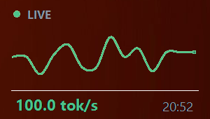

# lms-tokps — live tok/s systray widget for LM Studio

A tiny native Windows 11 widget that tails your LM Studio **server-logs** folder
and shows live **tokens/second** near the systray — as a **fully transparent**
widget: just a status dot, a smooth sparkline of the last ~60 seconds, and the
rate, floating straight over your desktop (no card, no background).



No .NET install needed — grab the self-contained exe from the
[releases](../../releases) and double-click it.

## Run

- **Easiest:** download `lms-tokps.exe` from a
  [release](../../releases) (self-contained, ~155 MB, just includes the runtime).
- **Or build:** see [Build](#build).

When it starts:

- A transparent widget appears in the bottom-right, just above the taskbar.
  It is intentionally **not draggable** — use **"Dock bottom-right"** in the
  menu to snap it back, or "Show/Hide widget" to toggle it.
- A tray icon appears in the systray (double-click it to show/hide the widget).
- Right-click the tray icon (or the widget) for the menu.

> If you don't see the tray icon, click the "Show hidden icons" chevron —
> it's intentionally small on purpose.

## What it shows

- **Graph** — the star. A smooth sparkline of the live rate over the last
  ~60 s, drawn as a flowing line in the current rate colour, with a head dot.
- **LIVE** (green dot, top-left) — the server is generating right now (a
  progress line was logged within the last 5 s). The rate line shows the
  **current** rate (`tg_3s`, tokens/s over the last 3 s of generation) in
  colour, plus `avg {tg} · {n_gen} tok · time` (trimmed so it never overlaps).
- **IDLE** — no recent generation; grey line with the last known rate and
  `last {time}`.
- Rate colours: 🟢 ≥ 100 tok/s · 🟡 ≥ 40 · 🟠 below.

## Menu (card or tray)

- **Show / Hide widget**
- **Pause / Resume updates**
- **Dock bottom-right** — snaps the widget back above the taskbar
- **Open logs folder**
- **Quit**

Hiding the widget (rather than Quit) keeps it running in the tray.

## Configuration

- Default log folder: `%USERPROFILE%\.lmstudio\apps\bionic\server-logs`
  (i.e. LM Studio Bionic server logs).
- Override the folder (command line wins over the saved setting):

  ```
  lms-tokps.exe --root="D:\path\to\server-logs"
  ```

- Window position, pause state and folder are remembered in
  `%AppData%\lms-tokps\settings.json` — delete that file to reset.

## How it finds the number

Every second it picks the newest `*.log` file under the folder, reads the last
512 KB, and parses the most recent live progress line:

```
n_gen = 900, tg = 75.83 t/s, tg_3s = 92.40 t/s
```

`tg` is the sustained average for the generation, `tg_3s` the rate over the
last 3 seconds. It also picks up `prompt eval time …` and the end-of-completion
`eval time … N tokens per second` summary as a fallback. Nothing else on disk
is read — the folder is only ever read, never written.

## Build

Requires the [.NET 8 SDK](https://dotnet.microsoft.com/download/dotnet/8.0).

```powershell
# from this folder
.\build.ps1          # → publish\lms-tokps.exe (self-contained, single file)
```

or by hand:

```
dotnet publish -c Release -r win-x64 --self-contained true -p:PublishSingleFile=true -o publish
```

## Project layout

| File | Purpose |
|---|---|
| `Program.cs` | Entry point, CLI (`--root`), 1 s polling timer |
| `WidgetForm.cs` | Transparent layered window, tray icon + menu, layout |
| `Sparkline.cs` | Catmull-Rom smoothed sparkline renderer (GDI+) |
| `LogWatcher.cs` | Tails newest `*.log`, regex-parses `tg` / `tg_3s` / `n_gen` |
| `Settings.cs` | JSON persistence under `%AppData%\lms-tokps` |

## License

MIT — see [LICENSE](LICENSE).
